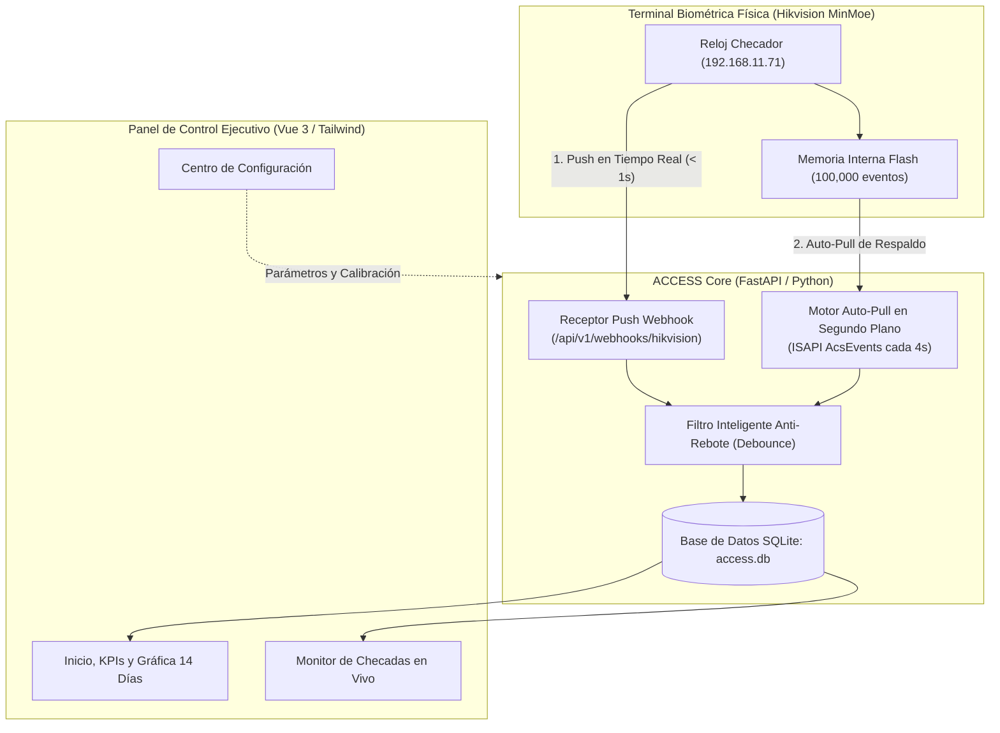

# ACCESS — Sistema de Control de Asistencia Biométrica y Pre-Nómina

ACCESS es una plataforma integral para la gestión y captura de checadas en tiempo real con terminales biométricas **Hikvision DS-K1T320MFWX-B** (y serie MinMoe compatible), control de incidencias, filtros anti-rebote inteligentes y exportación consolidada para pre-nómina.

---

## 1. Arquitectura de Ingesta Dual (Push + Pull)

Para garantizar alta disponibilidad y cero pérdida de checadas en entornos operativos:



1. **Patrón Push (Tiempo Real)**: La terminal envía cada checada instantáneamente por HTTP multipart a ACCESS en cuanto el colaborador coloca su huella o rostro.
2. **Patrón Pull (Auto-Pull de Respaldo)**: Un poller en segundo plano consulta la memoria del checador cada 4 segundos para asegurar que no se pierda ningún evento ante caídas de Wi-Fi o micro-cortes.
3. **Filtro Anti-Rebote (Debounce Dinámico)**: Si un colaborador checa dos o más veces seguidas por duda o distracción (ej. dentro de los 180 segundos), el sistema clasifica las repeticiones como "REBOTE IGNORADO" y preserva una única checada válida para pre-nómina.

---

## 2. Estructura del Proyecto

| Archivo / Carpeta | Propósito |
| :--- | :--- |
| [`run.py`](file:///c:/Users/TI/Documents/GitHub/ACCESS/run.py) | Punto de entrada del servidor de producción (FastAPI + Uvicorn). |
| [`iniciar.bat`](file:///c:/Users/TI/Documents/GitHub/ACCESS/iniciar.bat) | Script para iniciar el sistema con 1 clic en Windows. |
| [`main.py`](file:///c:/Users/TI/Documents/GitHub/ACCESS/main.py) | API REST, receptor de webhooks ISAPI, poller en segundo plano y endpoints. |
| [`access.db`](file:///c:/Users/TI/Documents/GitHub/ACCESS/access.db) | Base de datos SQLite de producción (checadas, empleados, áreas, relojes y configuración). |
| [`core/database.py`](file:///c:/Users/TI/Documents/GitHub/ACCESS/core/database.py) | Capa de persistencia, debounce anti-rebote, catálogos y gestión de parámetros. |
| [`assets/js/`](file:///c:/Users/TI/Documents/GitHub/ACCESS/assets/js/) | Aplicación Vue 3 modular (Inicio, Monitor, Relojes, Empleados, Áreas, Reportes, Configuración). |
| [`templates/`](file:///c:/Users/TI/Documents/GitHub/ACCESS/templates/) | Vistas HTML (Login y Dashboard ejecutivo con Dynamic Island). |
| [`setup_webhook_host.py`](file:///c:/Users/TI/Documents/GitHub/ACCESS/setup_webhook_host.py) | Utilidad para configurar el destinatario HTTP del checador vía ISAPI. |
| [`sync_clock_time.py`](file:///c:/Users/TI/Documents/GitHub/ACCESS/sync_clock_time.py) | Utilidad CLI para calibrar la hora oficial del hardware. |
| [`manage_employees.py`](file:///c:/Users/TI/Documents/GitHub/ACCESS/manage_employees.py) | Utilidad CLI para sincronización de empleados y biometría. |

---

## 3. Puesta en Marcha

### Inicio Rápido (Recomendado)
Haz doble clic sobre el archivo:
```bat
iniciar.bat
```
O desde la consola PowerShell:
```powershell
python run.py
```

### URLs de Acceso
- **Iniciar Sesión**: [http://localhost:8000/login](http://localhost:8000/login)
- **Panel Principal**: [http://localhost:8000/dashboard](http://localhost:8000/dashboard)
- **Receptor Webhook ISAPI**: `http://<IP_LOCAL>:8000/api/v1/webhooks/hikvision`

---

## 4. Centro de Configuración
Dentro del sistema encontrarás:
- Módulo **"Configuración"** en el menú lateral para ajustar tiempos de anti-rebote, calibrar la hora del reloj en 1 clic y verificar el enlace ISAPI.
