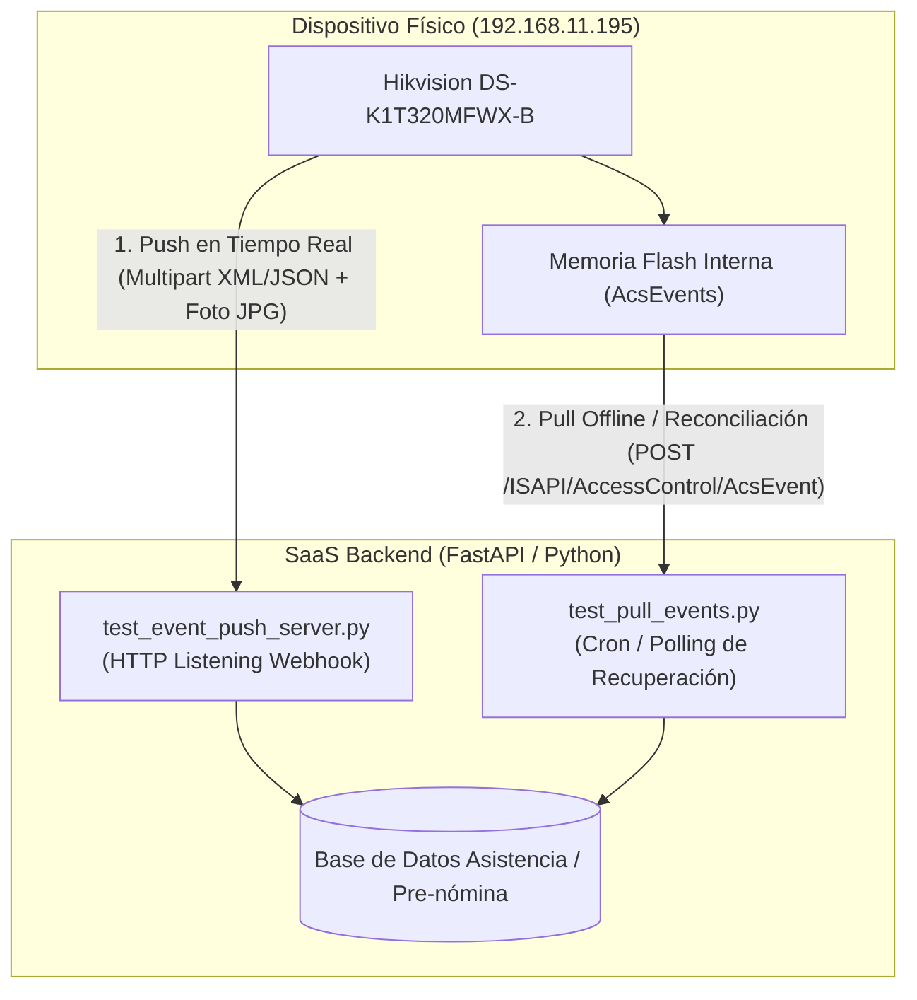

# Arquitectura de Integración Biométrica Hikvision ISAPI para SaaS de Asistencia y Pre-Nómina

Este repositorio implementa y valida el conjunto de pruebas técnicas para la integración de hardware biométrico **Hikvision DS-K1T320MFWX-B** (y terminales compatibles de la serie MinMoe) con una plataforma SaaS de control de asistencia, incidencias y cálculo de pre-nómina.

---

## 1. Arquitectura de Ingesta de Checadas

Para garantizar alta disponibilidad y tolerancia a fallas de red en clientes corporativos e industriales, se implementa una arquitectura híbrida:



1. **Patrón Push (Tiempo Real)**: El reloj envía cada checada instantáneamente al endpoint HTTP del SaaS usando `multipart/form-data`, adjuntando los metadatos y la fotografía del rostro capturada para validación antispoofing y auditoría.
2. **Patrón Pull (Offline Recovery / Reconciliación)**: Si el internet o la red local se interrumpe, el reloj almacena hasta 100,000 eventos en su memoria no volátil. El script `test_pull_events.py` ejecuta consultas paginadas a `POST /ISAPI/AccessControl/AcsEvent` para descargar y procesar las checadas faltantes sin pérdida de datos.

---

## 2. Estructura de Archivos

| Archivo | Propósito |
| :--- | :--- |
| [`.env`](file:///c:/Users/TI/Documents/GitHub/ACCESS/.env) | Credenciales y parámetros de conexión (Host, Puerto, Usuario, Password). |
| [`config.py`](file:///c:/Users/TI/Documents/GitHub/ACCESS/config.py) | Cargador de configuración y generación de URLs base ISAPI. |
| [`test_isapi_connection.py`](file:///c:/Users/TI/Documents/GitHub/ACCESS/test_isapi_connection.py) | **Tarea 1**: Diagnóstico de red, modelo, firmware, MAC y extracción de plantilla de empleados. |
| [`test_pull_events.py`](file:///c:/Users/TI/Documents/GitHub/ACCESS/test_pull_events.py) | **Tarea 2**: Extracción de eventos históricos almacenados en el reloj (`AcsEvent`). |
| [`test_event_push_server.py`](file:///c:/Users/TI/Documents/GitHub/ACCESS/test_event_push_server.py) | Servidor FastAPI + Uvicorn receptor de webhooks push y fotos en tiempo real. |
| [`simulate_push_event.py`](file:///c:/Users/TI/Documents/GitHub/ACCESS/simulate_push_event.py) | Generador de eventos de prueba simulados con foto para testeo del backend. |

---

## 3. Configuración y Ejecución

### Paso 1: Configurar la Contraseña
Abre el archivo [`.env`](file:///c:/Users/TI/Documents/GitHub/ACCESS/.env) y coloca la contraseña de administrador del reloj checador:
```env
HIK_HOST=192.168.11.195
HIK_PORT=80
HIK_USER=admin
HIK_PASS=TuPasswordReal
```
*(También puedes pasar la contraseña directamente con el argumento `--password` en cada script).*

> [!WARNING]
> Los dispositivos Hikvision cuentan con una directiva de bloqueo por seguridad: tras 5 intentos fallidos consecutivos de autenticación HTTP Digest, la cuenta de administrador se bloquea temporalmente por 30 minutos o hasta reiniciar el hardware. Asegúrate de verificar la contraseña antes de ejecutar en bucles automáticos.

---

### Paso 2: Ejecutar Diagnóstico de Red y Empleados (Tarea 1)
```powershell
python test_isapi_connection.py
```
**Operaciones verificadas:**
1. `GET /ISAPI/System/deviceInfo` (Digest Auth): Extrae Modelo, Nombre, Número de Serie, Dirección MAC y Versión de Firmware.
2. `POST /ISAPI/AccessControl/UserInfo/Search?format=json`: Obtiene el censo de empleados registrados en el reloj con su `employeeNo`, `name` y `userType`.

---

### Paso 3: Extraer Historial de Checadas Offline (Tarea 2)
```powershell
python test_pull_events.py --max 30
```
**Operaciones verificadas:**
1. `POST /ISAPI/AccessControl/AcsEvent?format=json` con filtros `major: 5` (Control de Acceso) y `minor: 0` (Todos).
2. Normalización de formatos (lista u objeto individual) y mapeo de identificadores de evento (`75` = Reconocimiento facial, `38` = Huella, `1` = Tarjeta).

---

### Paso 4 (Opcional): Probar Servidor Push en Tiempo Real
En una terminal:
```powershell
python test_event_push_server.py
```
En otra terminal (o simulador):
```powershell
python simulate_push_event.py
```
